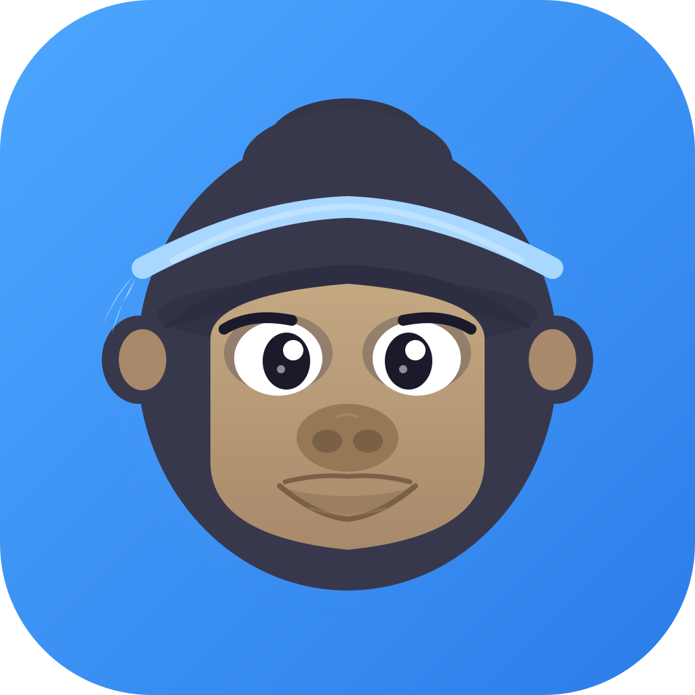
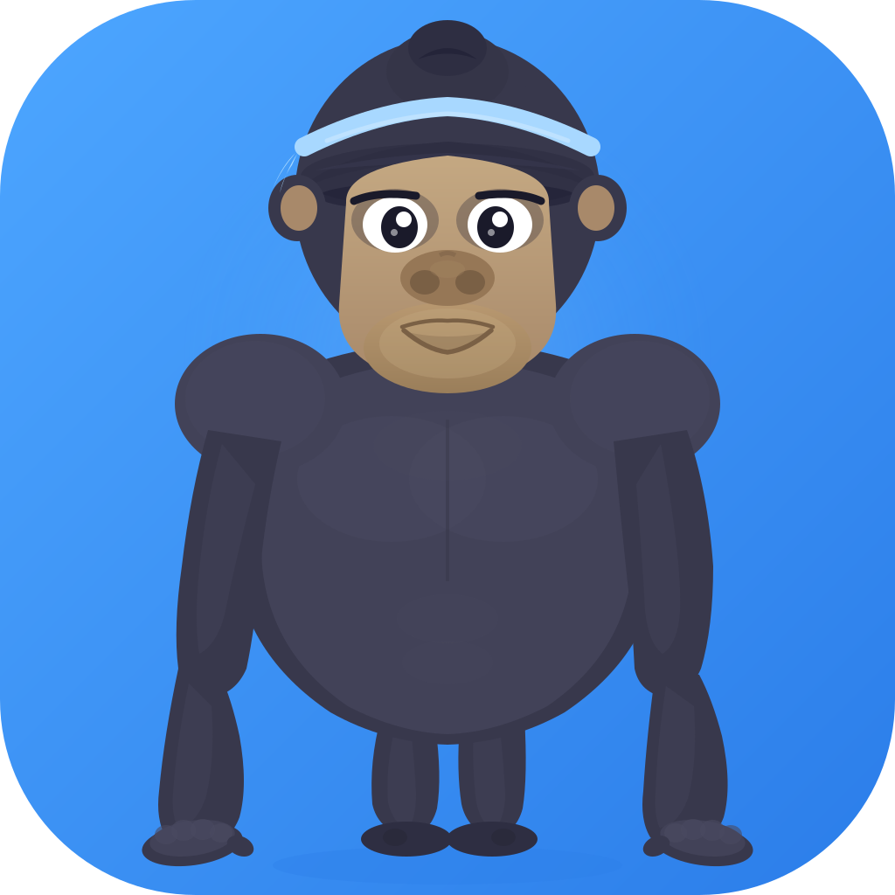
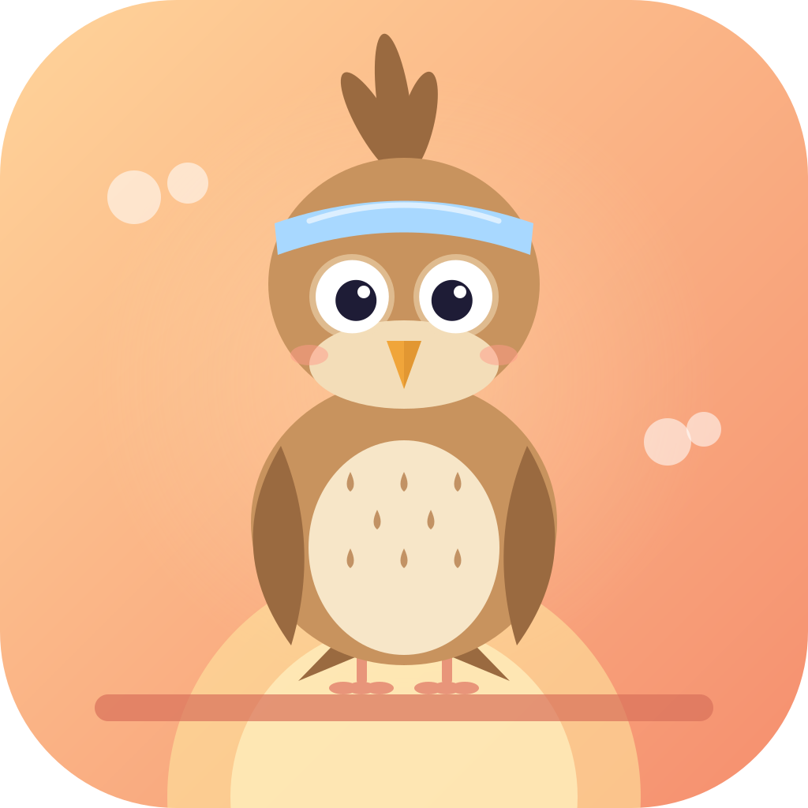
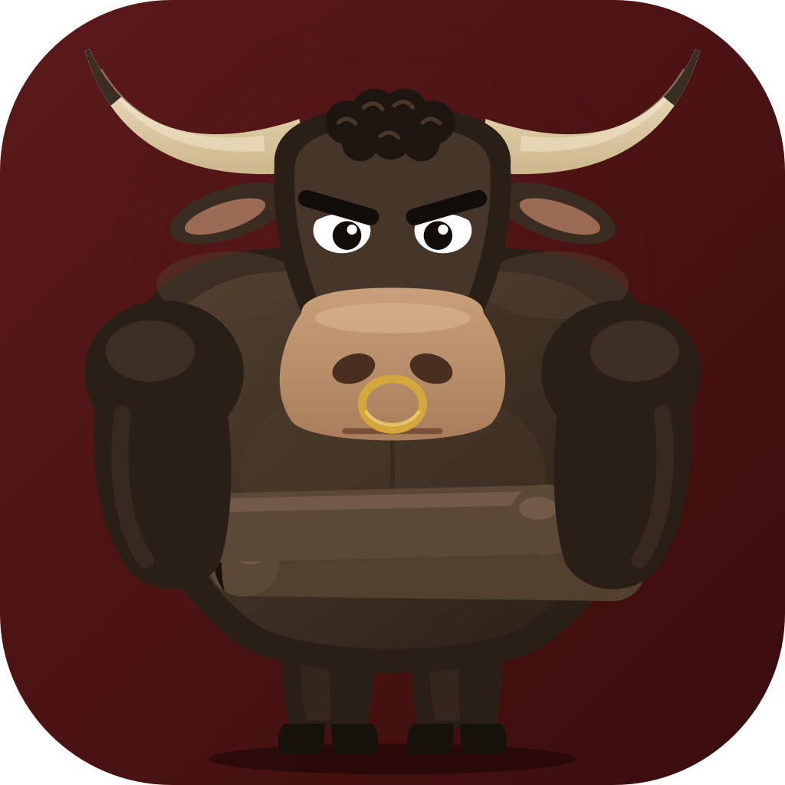

<p align="center">
  
</p>

<h1 align="center">TreniDay</h1>

<p align="center">
  <b>Free home workouts that feel like a game</b><br>
  Short bodyweight workouts with Goro the gorilla, from wall push-ups to a handstand.
</p>

<p align="center">
  <a href="https://pupptmstr.github.io/treniday/"><b>Website</b></a> ·
  <a href="https://pupptmstr.github.io/treniday/app/"><b>Web app</b></a> ·
  <a href="internal_docs/README.md">Project notes</a> ·
  <a href="docs/PRIVACY_POLICY.md">Privacy</a>
</p>

<p align="center">
  <a href="https://github.com/pupptmstr/treniday/actions/workflows/ci.yml"></a>
  <a href="https://github.com/pupptmstr/treniday/actions/workflows/web.yml"></a>
  
  
</p>

<p align="center">
  
  
  
  
  
  
</p>

TreniDay is a home-workout app with a game around it. It guides you from
absolute zero (wall push-ups, a first plank, a gentle stretch) to advanced
skills (handstand push-ups, L-sit, free handstand, the wheel) through short
daily workouts: five courses, each with a host of its own, and courses you put
together yourself. Free, with no ads, no subscriptions and no account;
everything stays on your device. The iPhone and Android apps are coming to the
stores; the [web version](https://pupptmstr.github.io/treniday/app/) works today.

---

> **Disclaimer**
>
> This project is developed primarily in collaboration with [Claude](https://claude.ai)
> (Anthropic) — an AI assistant that helps design architecture, write code, and
> documentation. All technical decisions are reviewed and approved by a human;
> Claude acts as a co-author, not an autopilot.

---

## Concept

The app is built on proven game-based learning mechanics:

| Mechanic          | How it works in TreniDay                                        |
|-------------------|----------------------------------------------------------------|
| Course            | A set of skill branches with its own host character             |
| Skill / branch    | A ladder of exercises (Push, Pull, Backbends…), easy to hard    |
| Session           | A short daily workout drawn from the course's branches          |
| Experience points | Strength Points (SP)                                            |
| Streak            | Consecutive training days, protected by freezes                 |
| Player levels     | Ranks: Beginner → Legend                                        |

## Courses

| Course | Host | Branches |
|--------|------|----------|
| **Calisthenics** | Goro the gorilla | Push (7 stages), Pull (6, needs a pull-up bar), Core (6), Legs (5), Balance (6), Flexibility (6) |
| **Healthy Body** | Raffi the giraffe | Posture (6), Neck (5), Flexibility (shared) |
| **Evening Stretch** | Luna the owl | Back (5), Hips (5), Folds (4), Shoulders (5) — calm stretching before sleep |
| **Morning Routine** | Aurora the lark | Spine (5), Joints (5), Arms (5), Energy (5) — standing, quiet, no jumps |
| **Yoga** | Miso the cat | Standing poses (5), Equilibrium (5), Backbends (6), Flow (5), Balance (shared) |
| **Your own** | one of the five, your pick | built-in branches (their progress is shared) and branches you make from any exercises in your order |

24 branches (20 in the courses, 4 outside them) with over 100 stages; 155
exercises in total with the warm-ups, cool-downs and the supplementary set. Progress belongs to the branch,
so a branch shared by two courses moves once for both. The full catalog with
every stage, amount and challenge norm is in [the exercise catalog](internal_docs/reference/courses.md#exercise-catalog).

## Features

- **Smooth progression:** reps ↑ → sets ↑ → rest ↓ → a Challenge (judged by Skala the bull) → the next stage; each branch moves on once a day, in any workout
- **Daily workout generation:** the branches take turns day by day; the size is Short, Standard or Full, and the Home button shows an honest time estimate that learns your pace; an arrow on the button unfolds the day's plan
- **Home screen:** before the first workout of the day the host's line, an open challenge to start right there, the next goals (SP to the next rank, the nearest achievement) and the course's branches; after it the latest workouts and what grew today (reps, a set, less rest, a new stage)
- **Hands-free workouts:** timed holds start after a get-ready countdown (pause if you need more time), holds on one side run on both with a switch-sides countdown, a sound of its own for every moment (all, key only or off) that plays over your music, and vibration
- **Course builder:** put a course together from any built-in branches, or make a branch of your own — pick exercises, put them in order, and the app sets the reps, sets, rests and challenges; own courses can be hidden from the course list without deleting them
- **Branches outside the courses:** Strong Back, Glutes, Arms & Shoulders and Cardio — put them into your own course
- **Goro's animations for every exercise** — 148 Lottie files, most of them generated in-house with `tools/lottie`, shown wherever an exercise is named (cropped to the figure in small thumbnails)
- **Course hosts:** each course has its host with six moods on Home and in the Profile, speaking in its own voice (four lines per mood, a new one on every visit or tap) and greeting you by name, cheering on the summary and holding the course's achievements — a grey medal with a padlock while one is still ahead; Goro has a few fun poses on About (tap him)
- **Gamification:** Strength Points, streaks and freezes, ranks with a display-only decay after long breaks, 45 achievements, bonus workouts
- **History:** a workout calendar with a heatmap, tappable streak / SP / rank stats
- **Exercise library** with search in every language and tag filters; **custom routines** (a quick one by focus, or saved ones)
- **"What's new"** under the bell in the profile: the latest updates in full and the whole version history, folded
- **Notifications:** morning reminder, evening nudge, streak at risk, streak lost, rank at risk
- **Home-screen widgets with Goro** (iOS + Android): Today (the day's plan, the week, the streak — three sizes), Goro (his mood follows your day), Streak and Rank; on iPhone also on the lock screen. Every text in the app's language
- **Health integration:** Apple Health and Health Connect — the workout and its calories, if you want
- **Languages:** English, Russian, German and Spanish (German and Spanish are drafts awaiting native proofreading)
- **Dark theme**, onboarding with a push-up calibration and course choice
- **Web version** at https://pupptmstr.github.io/treniday/app/ (installable as a PWA; data stays in the browser — no notifications, Health or widget there)
- **Website** at https://pupptmstr.github.io/treniday/ in the app's four languages
- **100% offline** — no server, all data on the device (Hive)

## Tech Stack

| Layer              | Technology                  |
|--------------------|-----------------------------|
| Platform           | Flutter (Dart)              |
| State management   | Riverpod 3.x                |
| Local storage      | Hive CE                     |
| Navigation         | go_router                   |
| Animations         | Lottie (generated by `tools/lottie`) |
| Notifications      | flutter_local_notifications |
| Target platforms   | iOS (primary), Android, Web (PWA) |

## Project Structure

```
lib/
├── main.dart                  # Entry point, Hive init, migrations
├── core/                      # Router, theme, services (notifications, sound, Health, widget), l10n helpers, DST-safe date utils
├── data/
│   ├── models/                # Hive models: UserProfile, SkillProgress, WorkoutLog, CustomRoutine, CustomBranch, CustomCourse…
│   ├── repositories/          # Hive access: user, progress, workouts, achievements, custom routines, own branches and courses
│   └── static/                # Catalogs: exercises, supplementary set, tags, courses, achievements, release notes
├── domain/
│   ├── models/                # WorkoutPlan, Branch / Course (built-in or the user's own)
│   └── services/              # SP, streak, rank decay, progression, workout generator, own-branch stages, achievements, notification plan
└── features/
    ├── onboarding/
    ├── home/                  # Home, Branch Journey
    ├── workout/               # Workout screen, summary
    ├── library/               # Courses tab, exercise library, routine / course / branch builders
    ├── profile/               # Profile, achievements, calendar, "What's new"
    └── settings/

test/                          # 1160+ tests: services, catalog integrity, Hive repositories, ARB files, notification plan, router, workflows
assets/animations/             # Lottie exercise animations (148 files)
assets/goro, assets/skala, assets/hosts   # Mascot, judge and course hosts (SVG)
tools/lottie/                  # Animation rigs and generators (gen_*.py per branch or course), checks, preview stands
tools/characters/              # Generators of Goro's poses, Skala and the course hosts
tools/sounds/                  # Generator of the workout cues
site/, tools/site/             # The landing page (template + strings per language) and its build script
fastlane/metadata/             # The App Store and Google Play listings in four languages (tools/store/check_listing.py checks them)
web/                           # Web shell (index.html, manifest, icons); deployed by .github/workflows/web.yml
.github/workflows/             # web.yml (Pages deploy), ci.yml (l10n, analyze, test, Android debug build on push / PR), release.yml (release builds, disabled)
```

## Quick Start

**Requirements:** Flutter 3.47.7 (stable, the version CI uses), Dart ≥ 3.11; iOS 16+, Xcode 27 with CocoaPods; Android builds need JDK 17 or 21

```bash
# Install dependencies
flutter pub get

# Generate Hive adapters (required on first clone or after model changes)
dart run build_runner build --delete-conflicting-outputs

# Generate localizations
flutter gen-l10n

# Run
flutter run

# Tests
flutter test

# Linter
flutter analyze
```

## Gamification

**Strength Points (SP)** — awarded for each completed exercise.
+50% for the first workout of the day, +10% for completing every set; a bonus workout the same day earns half.

**Ranks:**

| Rank      | SP      |
|-----------|---------|
| Beginner  | 0       |
| Amateur   | 500     |
| Athlete   | 2,000   |
| Champion  | 5,000   |
| Master    | 15,000  |
| Legend    | 50,000  |

A rank that is not trained for 21 days is *shown* one tier lower (further tiers at 35, 45, 53 and 59 days); the earned rank is never lost and returns with the next workout. A warning notification comes after 14 days.

**Streak freezes:** one every 7 streak days (up to 3); a freeze saves the streak after one missed day.

## Documentation

- [Project notes](internal_docs/README.md) — the index: [status](internal_docs/STATUS.md), [changelog](internal_docs/CHANGELOG.md), the reference by topic (data, courses, progression, workout, screens, platforms, testing, tooling), decisions, specs
- [Design system](design-system/treniday/BRAND.md) — brand, mascot and hosts, colours, UX rules
- [Privacy Policy](docs/PRIVACY_POLICY.md) · [Terms of Use](docs/TERMS_OF_USE.md)

## Roadmap

- **0.1 – 0.7 ✅** (numbered 1.x until April 2026): the first branches and gamification, sound, widget, Health, Friends, courses, the exercise library, custom routines
- **0.8 ✅:** calendar and interactive stats, rank decay, the web version, animations for the exercises of the first courses, the get-ready countdown and holds on each side, workout sizes with a learned estimate, German and Spanish, Evening Stretch and the course hosts
- **0.9 ✅:** Morning Routine, Yoga, an animation for every exercise, the course builder, "What's new" with the whole history, a fuller Home with the plan in the workout button, animations wherever an exercise is named, the hosts' own voices; Friends removed (without a server they added little), the host greets you by name, four branches outside the courses; a sound for every moment of a workout; widgets with Goro and the iOS lock screen (0.9.7); the website and every workout sound in the web version on iPhone (0.9.8)
- **Next ideas:** app performance, vibration patterns of our own, maybe a new name — see [STATUS § Ideas](internal_docs/STATUS.md)
- **v1.0:** the first store release — store accounts, proofread German and Spanish
- **Later:** "Support the author" (in-app tips)

## License

© 2026 the author of TreniDay. **All rights reserved.** The source is open to
read, but it is not licensed for use: copying, modifying, distributing or
building on it needs written permission — see [LICENSE](LICENSE). Using the
app is governed by the [Terms of Use](docs/TERMS_OF_USE.md).
